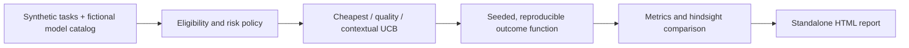

# Model Routing Arena

**What if the same AI workload were routed through different model-selection strategies?**

A reproducible, provider-free simulator that sends synthetic support, code, and analysis requests to four **fictional** AI models. Compare routing policies with a shared deterministic outcome table, a real contextual UCB selection algorithm, hard high-risk eligibility checks, and a standalone HTML dashboard.

  

## Quick start

```bash
python -m routing_arena demo --out examples/arena_report.html
python -m unittest discover -s tests -v
```

Open [`examples/arena_report.html`](examples/arena_report.html) in a browser. The demo includes 42 synthetic requests, four fictional models, three strategies, a per-request trace, and a readable success-rate visualization. No `pip install`, API key, or cloud account required.

## Routing strategies

- **Cheapest:** choose the least expensive eligible model using illustrative per-million-token prices.
- **Quality-first:** choose the highest preconfigured success probability for the task type and difficulty.
- **Adaptive UCB:** per-context exploration and upper-confidence-bound exploitation using observed rewards, not actual learning from LLM logs.

The safety policy runs *before* routing: `risk=high` tasks are dispatched only to models explicitly marked `high_risk_approved`. A missing eligible model causes a validation failure rather than a fallback.

## Architecture



## Why this is an interesting engineering project

A single replay seed supplies consistent provider outcomes across strategies; model outcomes do not change simply because one strategy invokes them in a different order. A per-task hindsight oracle measures *diagnostic regret* (not a realizable production policy). The experiment records p95 latency, success rate, approximate token cost, per-model assignment count, and decision traces. All policies share the same eligible-model rules.

The simulation uses deterministic SHA-256 draws to produce outcomes, an explicit quality model, and a seeded latency jitter. The routing model is intentionally inspectable, not intended to be an accurate benchmark of actual Gemini, Vertex AI, or other providers.

## Adapt the demo

Edit [`fixtures/workload.json`](fixtures/workload.json) to change model quality/price assumptions, risk authorization, or request mix. Use `--seed 12` to run a different repeatable experiment. Tests cover validation, deterministic comparison, policy eligibility, reporting, and HTML escaping.

## Limitations and next production steps

- **No real LLM calls**, provider SDKs, real quality benchmarks, or live token counts. The four models are fictional.
- The difficulty/quality/price functions are illustrative and not learned from user data. UCB is evaluated in a simple stationary toy setting.
- A hindsight oracle can inspect all mock outcomes, so its regret score is not a production estimate.
- For a production extension: connect real provider adapters, instrument latency/cost, run consented evaluation sets, enforce content policies independently of model routing, monitor tail latency, and use offline significance testing before automatic rollout.

See [`DESIGN.md`](DESIGN.md) for design choices, invariants, and test scenarios.

MIT licensed; synthetic data only.
